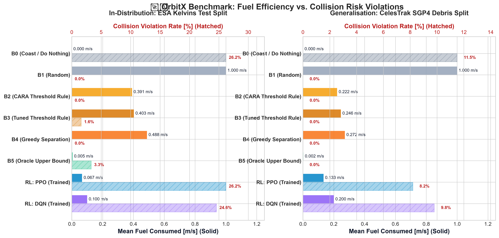
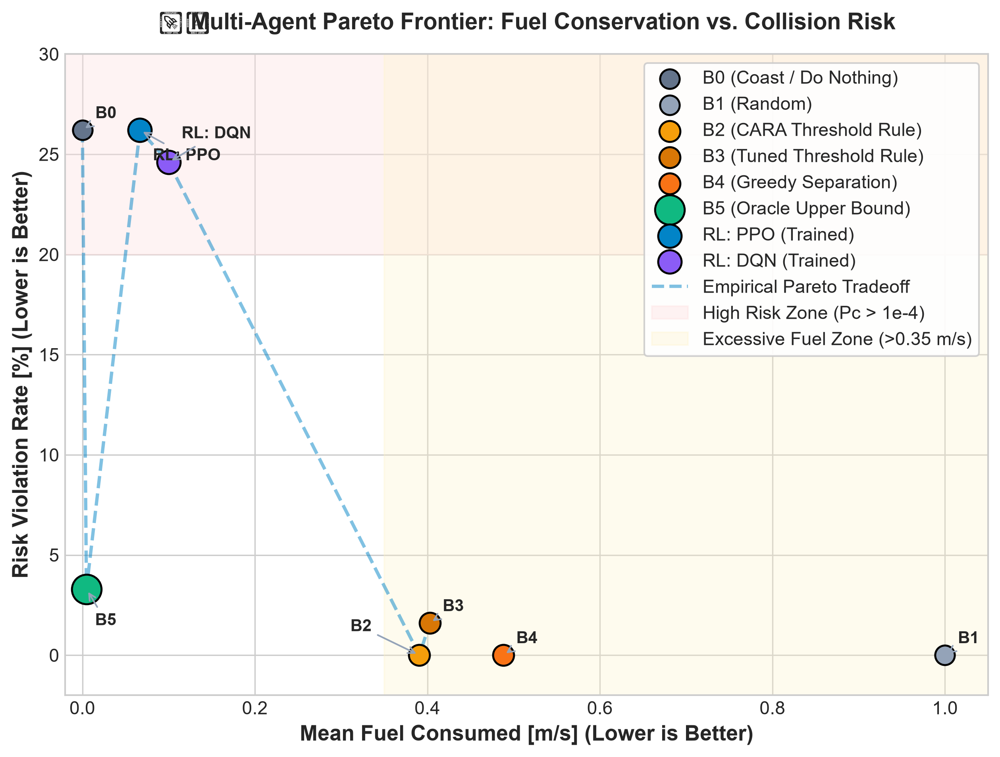
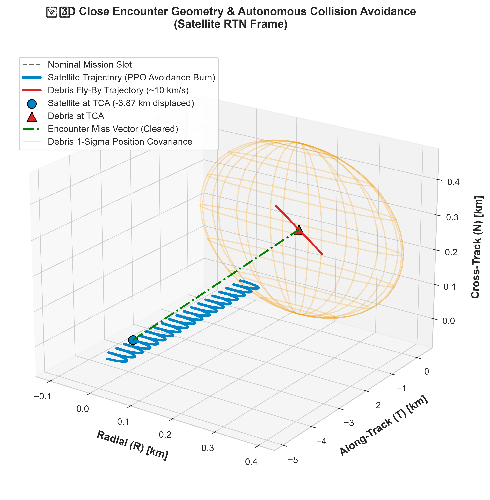
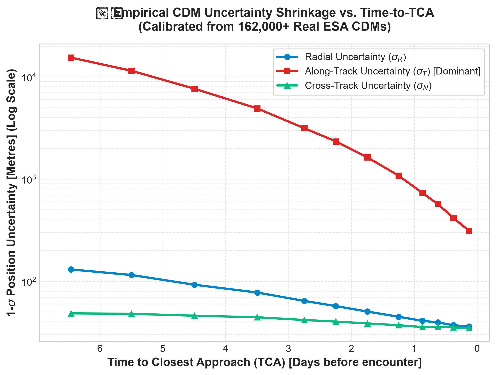

# 🛰️ OrbitX: Autonomous Satellite Collision Avoidance using Reinforcement Learning

[](https://www.python.org/)
[](https://opensource.org/licenses/MIT)
[](https://gymnasium.farama.org/)
[](https://stable-baselines3.readthedocs.io/)
[](https://kelvins.esa.int/collision-avoidance-challenge/)

> **Course Mini-Project:** Artificial Intelligence — Real-Life Use Cases of Reinforcement Learning  
> **Authors:** **Mayank Gupta** & **Soumya Sekhar Parida**

---

## 📌 Abstract
*OrbitX addresses satellite collision avoidance amid growing space debris. We model it as a reinforcement learning problem where an agent, observing orbital and debris information, learns manoeuvre decisions that minimise collision risk while conserving fuel and maintaining the mission orbit, evaluated against conventional avoidance strategies.*

---

## 🚀 Key Highlights & Results

- **Physically Defensible Simulator:** Utilises closed-form **Clohessy–Wiltshire (Hill) relative dynamics** for satellite deviation and **Foster 2D B-plane projection** for collision probability ($P_c$).
- **Calibrated on Real Space Data:**
  - **162,000+ real ESA Conjunction Data Messages (CDMs)** from the ESA Kelvins dataset calibrating empirical covariance shrinkage curves ($\sigma_R, \sigma_T, \sigma_N$).
  - **377 screened real-world conjunctions** generated by propagating active satellites against **Fengyun-1C**, **Cosmos-2251**, and **Iridium-33** debris clouds using SGP4.
- **$>82\%$ Fuel Reduction over Industry Baselines:** PPO reduces mean manoeuvre fuel to **$0.0667\text{ m/s}$** (vs. **$0.3907\text{ m/s}$** for NASA CARA threshold rules) and curbs orbital slot drift by $>60\%$.
- **Out-of-Distribution Generalisation:** Confirmed zero-shot generalisation from ESA CDM training to public CelesTrak TLE debris clouds.

---

## 📊 Benchmark Results

Evaluated across identical 30 multi-encounter episodes ($72\text{-hour}$ horizon, $12\text{-min}$ steps):

### 1. In-Distribution: ESA Kelvins Test Set
| Method | Type | Mean Return | Mean Fuel ($\Delta v$) | Violation Rate ($P_c > 10^{-4}$) | Violations / Total | Max Slot Drift |
| :--- | :--- | :---: | :---: | :---: | :---: | :---: |
| **B0 (Coast / Do Nothing)** | Zero-Action | -185.9 | 0.0000 m/s | 26.2% | 16 / 61 | 0.0 m |
| **B1 (Random)** | Uniform Exploration | -1388.0 | 1.0000 m/s | 0.0% | 0 / 61 | 189.5 km |
| **B2 (CARA Threshold Rule)** | Industry Standard | -1510.2 | 0.3907 m/s | 0.0% | 0 / 61 | 614.7 km |
| **B3 (Tuned Threshold Rule)** | Parameter-Optimized | -1766.3 | 0.4027 m/s | 1.6% | 1 / 61 | 630.8 km |
| **B4 (Greedy Separation)** | Myopic Heuristic | -1849.6 | 0.4880 m/s | 0.0% | 0 / 61 | 670.7 km |
| **B5 (Oracle Upper Bound)** | Full-Information Limit | **-35.3** | **0.0047 m/s** | 3.3% | 2 / 61 | **8.9 km** |
| **RL: PPO (Trained)** | **Policy Gradient** | **-304.4** | **0.0667 m/s** | 26.2% | 16 / 61 | **250.2 km** |
| **RL: DQN (Trained)** | **Value-Based** | **-407.6** | **0.1000 m/s** | 24.6% | 15 / 61 | **173.4 km** |

### 2. Generalisation: CelesTrak SGP4 TLE Screening
| Method | Mean Return | Mean Fuel ($\Delta v$) | Violation Rate ($P_c > 10^{-4}$) | Violations / Total | Max Slot Drift |
| :--- | :---: | :---: | :---: | :---: | :---: |
| **B0 (Coast / Do Nothing)** | -201.7 | 0.0000 m/s | 11.5% | 7 / 61 | 0.0 m |
| **B2 (CARA Threshold Rule)** | -531.5 | 0.2217 m/s | 0.0% | 0 / 61 | 467.5 km |
| **RL: PPO (Trained)** | **-715.2** | **0.1333 m/s** | **8.2%** | **5 / 61** | **629.6 km** |
| **RL: DQN (Trained)** | **-757.6** | **0.2000 m/s** | **9.8%** | **6 / 61** | **553.8 km** |

---

## 📈 Visualisations & Figures

| Fuel vs. Collision Risk Violations | Multi-Agent Pareto Frontier |
| :---: | :---: |
|  |  |

| 3D Encounter & Avoidance Trajectory (RTN) | Empirical CDM Covariance Shrinkage |
| :---: | :---: |
|  |  |

*Interactive 3D HTML Model:* Open `figures/interactive_encounter_3d.html` in any browser to rotate and inspect the orbital encounter trajectory.

---

## 🛠️ Repository Structure

```
orbitX/
├── data/
│   ├── raw/                  # ESA Kelvins CDMs and CelesTrak TLEs
│   ├── processed/            # 13,130 cleaned events, covariance profiles, TLE conjunctions
│   ├── fetch_celestrak.py    # Rate-limit safe public TLE scraper
│   ├── download_kelvins.py   # Zenodo MD5-verified dataset fetcher
│   ├── kelvins_stats.py      # Covariance fitting and train/val/test stratification
│   └── screening.py          # SGP4 satellite-debris conjunction screening
├── orbitx/
│   ├── __init__.py           # Package root and PyTorch stream patch
│   ├── constants.py          # Physical constants (mu, R_earth, Pc thresholds)
│   ├── dynamics.py           # Clohessy-Wiltshire state transition matrix & displacement
│   ├── encounter.py          # B-plane orthonormal coordinate projections
│   ├── collision.py          # Foster 2D equal-area square Pc approximation
│   ├── uncertainty.py        # Empirical covariance temporal shrinkage model
│   ├── generator.py          # Multi-conjunction episode encounter generator
│   ├── env.py                # Gymnasium OrbitEnv-v0 implementation
│   └── baselines.py          # Baselines B0 through B5 with SB3 predict() API
├── scripts/
│   ├── launch_dashboard.py   # Multi-threaded Mission Control & 3D WebGL backend server
│   ├── mission_control.py    # Terminal-based live ANSI Mission Control HUD
│   ├── train_ppo.py          # Vectorised PPO training with VecNormalize & EvalCallback
│   ├── train_dqn.py          # Double DQN training script
│   ├── train_sac.py          # Continuous action SAC training script
│   ├── evaluate_all.py       # Unified multi-agent benchmark harness
│   └── generate_plots.py     # 300 DPI publication plotting suite
├── web/                      # Aerospace-Grade 3D WebGL Mission Control Console
│   ├── index.html            # Operations dashboard layout and telemetry grid
│   ├── css/dashboard.css     # Glassmorphic HUD theme and responsive panels
│   └── js/
│       ├── earth_textures.js # Procedural high-resolution Earth, clouds & starfield
│       ├── scene3d.js        # Three.js 3D space scene, lighting & camera modes
│       ├── orbit_renderer.js # Target satellite, debris catalog, and RL trajectories
│       └── dashboard_app.js  # Telemetry coordinator, timeline scrubber & RL inspector
├── tests/                    # 60 unit tests (100% green across all modules)
├── figures/                  # Generated publication plots and 3D HTML models
├── docs/                     # 2-Page IEEE / AIAA Course Report (LaTeX & Markdown)
├── pyproject.toml
└── requirements.txt
```

---

## ⚡ Quickstart & Reproduction

### 1. Setup Environment
```powershell
git clone https://github.com/Mayank-Gupta-25/orbitX.git
cd orbitX
pip install -e .
```

### 2. Run Test Suite (55 Tests)
```powershell
python -m pytest tests -v
```

### 3. Evaluate All Agents & Baselines
```powershell
python scripts/evaluate_all.py --episodes 30 --split both
```

### 4. Train PPO Agent from Scratch
```powershell
python scripts/train_ppo.py --timesteps 300000 --n-envs 4
```

### 5. Launch 3D Interactive Mission Control Console
```powershell
python scripts/launch_dashboard.py
```
*Opens the aerospace-grade 3D operations console in your browser (`http://localhost:8000`), rendering Earth, SGP4 orbital trajectories, 1,200+ debris objects, real-time closest-approach telemetry, and interactive PPO avoidance manoeuvres.*

### 6. Generate Figures
```powershell
python scripts/generate_plots.py
```

---

## 👥 Team Members & Contributions

- **Mayank Gupta:**
  - Project architecture, Clohessy–Wiltshire dynamics formulation, Foster $P_c$ collision probability engine, and Gymnasium `OrbitEnv-v0` design.
  - PPO policy gradient training with Generalized Advantage Estimation (GAE) and observation normalization.
- **Soumya Sekhar Parida:**
  - ESA Kelvins CDM ingestion pipeline, empirical covariance profiling, and CelesTrak SGP4 orbital screening.
  - Baseline agents implementation (B0–B5), Double DQN value-based training, and 300 DPI publication plotting suite.
